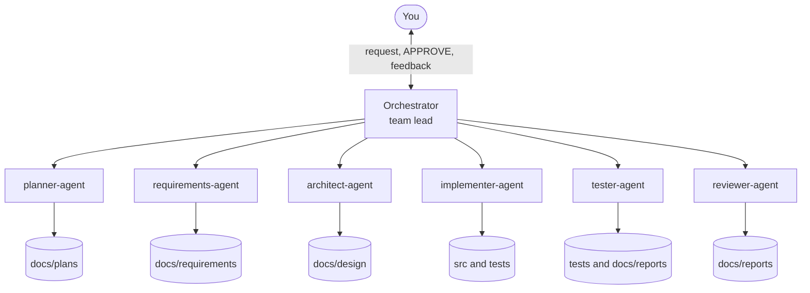
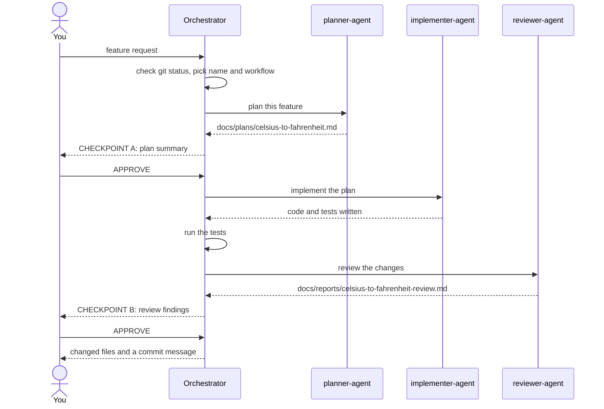
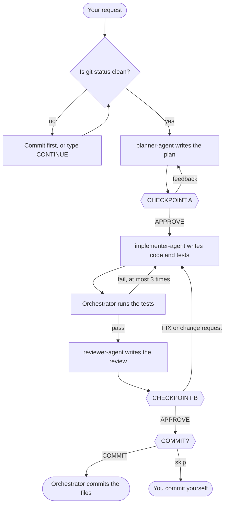
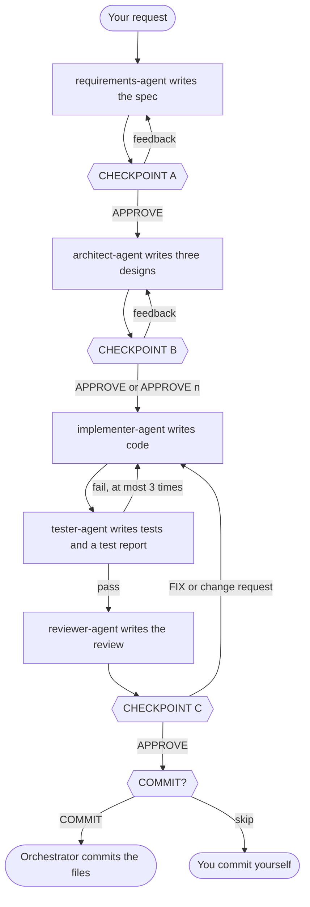
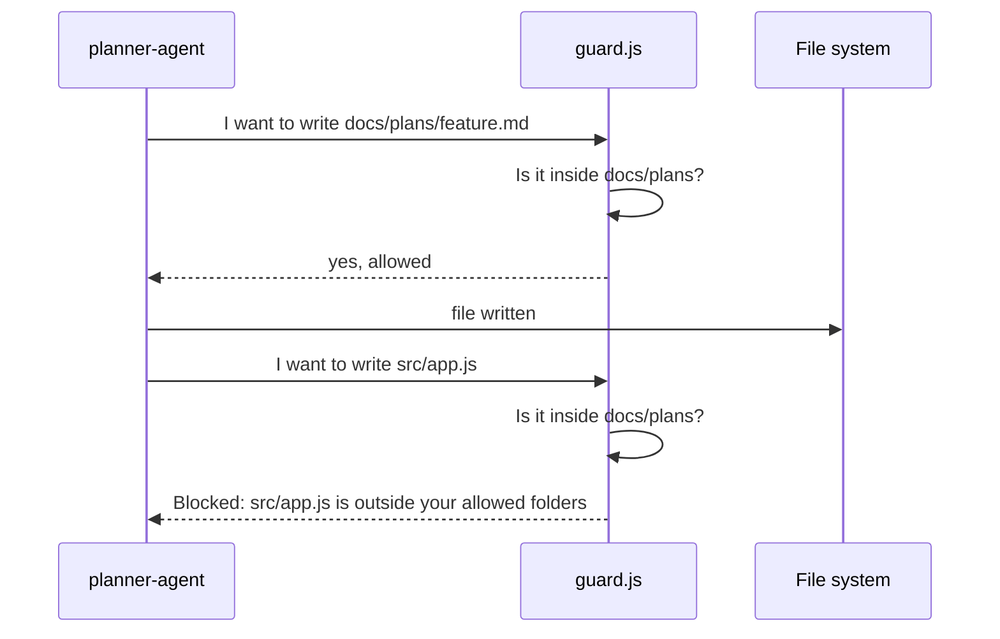

# Tutorial: build your first feature with a team of AI agents

This tutorial walks you through your first feature with this template, step by step.
You do not need any earlier experience with Claude Code agents.
It takes about 30 minutes.

## What you will learn

* What an agent, a subagent, and an orchestrator are
* How a feature moves from an idea to reviewed, tested code
* How to steer the AI at checkpoints instead of letting it run on its own
* How hooks keep each agent inside its own area
* How to read the plan, the tests, and the review that the agents produce

## The big idea: a small software team

Imagine a small software company.
You are the customer.
You talk to a team lead, and the team lead hands the work to specialists.
Each specialist has their own desk and may only put papers on that desk.

This template works the same way:

* **You** describe the feature and approve the work.
* The **orchestrator** is the team lead. It never writes code; it decides who works next and stops to ask you at important points.
* The **agents** are the specialists. Each one does one job and writes only into its own folder.



Why split the work at all, when one AI could do everything?

* **Focus.** Each agent gets a short, clear job, so it makes fewer mistakes.
* **Fresh eyes.** The reviewer did not write the code, so it is more likely to notice problems.
* **Control.** You approve the plan before any code is written, which is much cheaper than fixing the wrong code later.
* **Safety.** An agent that only plans cannot change your code, even by accident.

## Key words

| Word | Meaning |
| --- | --- |
| Agent | An AI assistant with one job, its own instructions, and a limited set of tools. |
| Subagent | An agent started by another agent. It cannot see your conversation, only what it is given. |
| Orchestrator | The agent you talk to. It calls the other agents in a fixed order. |
| Checkpoint | A point where the orchestrator stops and waits for your answer. |
| Acceptance criterion | One numbered, checkable rule that the finished feature must meet. |
| Hook | A small script that runs before an agent's action and may block it. |
| Guard | A hook that blocks writes outside the agent's folders, or shell commands other than the tests. |
| Sandbox | An extra layer that keeps shell commands inside the project folder. |

## Step 1: check your tools

Open a terminal and run these three commands:

```sh
claude --version
node --version
gh auth status
```

You should see a version number for Claude Code, Node.js 20 or newer, and a line saying you are logged in to GitHub.
If one of them fails, install that tool first: see the Prerequisites section in `README.md`.

## Step 2: create your project

Create a new repository from the template.
With the `newapp` shell function from the README:

```sh
newapp temp-converter
```

Without it:

```sh
gh repo create temp-converter --template pohjus/claude-multi-agent-template --private --clone
cd temp-converter
```

You now have a folder that looks like this:

```text
temp-converter/
├── CLAUDE.md            what every agent should know about the project
├── README.md            reference guide
├── TUTORIAL.md          this file
├── .claude/
│   ├── agents/          one file per agent: its job and its limits
│   ├── hooks/           the guard scripts
│   ├── settings.json    sandbox and logging
│   └── workflow.json    folder names and the test command
├── docs/                plans, specs, designs, and reports go here
├── src/                 your code goes here
└── tests/               your tests go here
```

## Step 3: describe your project

Open `CLAUDE.md` and replace the TODO lines in the `# Project` section:

```markdown
# Project

* Stack: Node.js 20+, plain JavaScript, CommonJS, no dependencies.
* Test command: node --test
* Test file naming: `tests/<name>.test.js`; the test command must find these files without arguments.
* Source folder and test folder: see `paths` in `.claude/workflow.json`.
```

Every agent reads this file, so this is where you tell the whole team about your project.

Save it and commit:

```sh
git add CLAUDE.md
git commit -m "chore(CLAUDE.md): describe project stack"
```

The orchestrator wants a clean working tree before it starts, so always commit first.

## Step 4: start the orchestrator

```sh
claude --agent orchestrator
```

The first time you open Claude Code in a new folder, it asks whether you trust the folder.
Answer yes.

Each step below takes a minute or two while the agents work.
The whole feature takes about 5 minutes, plus the time you spend reading.

## Step 5: ask for your first feature

Type your request in plain words:

```text
Add a function celsiusToFahrenheit(c) in src/convert.js that converts
Celsius to Fahrenheit and throws a TypeError for non-number input.
```

Here is the whole conversation you are about to have:



### What happens first

The orchestrator:

1. checks that `git status` is clean;
2. picks a short feature name, such as `celsius-to-fahrenheit`, that every file name will use;
3. chooses the **light workflow**, because this is a small feature, and tells you why;
4. sends your request to `planner-agent`.

From now on, the orchestrator prints a progress list every time something changes:

```text
LIGHT WORKFLOW: celsius-to-fahrenheit

 [>] 1. Plan           planner-agent   <- now
 [ ]    Checkpoint A   you: APPROVE or feedback
 [ ] 2. Implement      implementer-agent
 [ ] 3. Run tests      orchestrator
 [ ] 4. Review         reviewer-agent
 [ ]    Checkpoint B   you: APPROVE or FIX
 [ ]    Commit         you: COMMIT or skip

Next: Nothing to do yet.
```

`[x]` means done, `[>]` means running now, and `[ ]` means still to come.
`[!]` means the orchestrator has stopped and waits for you.
If you ever feel lost, look at the `Next:` line: it says whether you need to type anything, and what.

### Checkpoint A: read the plan

The orchestrator stops and shows a summary of the plan.
Open the full plan in your editor: `docs/plans/celsius-to-fahrenheit.md`.

A plan has these sections: Goal, Scope, Acceptance criteria, Approach, Risks.
The most important part is the acceptance criteria, for example:

```markdown
1. [test] celsiusToFahrenheit(0) returns 32.
2. [test] celsiusToFahrenheit(100) returns 212.
3. [test] Passing a string throws a TypeError.
4. [review] The function is exported by name from src/convert.js.
```

Your real plan will be longer.
In our test run, the planner wrote 16 criteria for this small function, covering cases such as `NaN`, `Infinity`, and negative numbers.
That is normal: the planner tries to pin down every edge case before any code exists.

* `[test]` criteria are about behaviour, so they become automated tests.
* `[review]` criteria are about how the code is written, so the reviewer checks them by reading the code.

Ask yourself: is anything missing, or anything I did not want?
This is the cheapest moment to change your mind.

Try giving feedback instead of approving:

```text
Also round the result to one decimal.
```

The planner updates the plan, and you come back to checkpoint A.
When the plan looks right, type:

```text
APPROVE
```

### Behind the scenes: implementing and testing

`implementer-agent` writes the code in `src/` and one test per `[test]` criterion in `tests/`.
Then the orchestrator runs `node --test` itself, so it does not have to take the implementer's word for it.
If a test fails, the failure goes back to the implementer, at most 3 times.

### Checkpoint B: read the review

`reviewer-agent` reads the changes and writes `docs/reports/celsius-to-fahrenheit-review.md`.
Findings are grouped into **Must fix**, **Should fix**, and **Nice to have**.
The reviewer also checks that every `[test]` criterion really has a test.

* If you are happy, type `APPROVE`.
* If you want the Must fix and Should fix findings fixed, type `FIX`.
* You can also write your own change request; it is handled like `FIX`.

### Finishing

After your last `APPROVE`, the orchestrator lists the changed files, suggests a commit message, and asks:

```text
Add and commit these files? Type COMMIT, or anything else to skip.
```

Before you answer, look at the changes yourself in another terminal:

```sh
git diff
node --test
```

Type `COMMIT` and the orchestrator runs `git add` and `git commit` for you.
It never pushes; run `git push` yourself when you want to.
If you would rather commit by hand, type anything else, for example `skip`, and it shows you the commands.

Congratulations, you built your first feature with a team of agents.

## The light workflow at a glance



## How to answer a checkpoint

| You type | What happens |
| --- | --- |
| `APPROVE` | Continue to the next step. |
| `APPROVE 2` | At the design checkpoint of the full workflow: use design 2 instead of the recommended one. |
| `FIX` | At the last checkpoint: fix the Must fix and Should fix findings, then test and review again. |
| Any other text | Feedback. Before the last checkpoint it goes to the agent that wrote the file; at the last checkpoint it starts a fix round. |
| A question | The orchestrator answers it and waits at the same checkpoint. |

Only the exact word `APPROVE` moves the work forward.
"Looks good" or "ok" counts as feedback, not as approval.

Sometimes an agent stops and asks you something instead of delivering:

* questions about an unclear request;
* a proposal to split a big request into smaller features;
* a proposal to switch to the full workflow;
* a report that the plan, the spec, or a test seems wrong.

The orchestrator shows it to you and waits for your answer.

## The full workflow

For bigger features, ask for the full workflow explicitly:

```text
Use the full workflow. Add a command line program that converts
temperatures between Celsius, Fahrenheit, and Kelvin.
```

It adds a written spec, three design options to choose from, and a separate tester:



Use the light workflow for most things.
Use the full workflow when the feature touches several parts of the program or there is a real choice between designs.
For a typo, skip both: start plain `claude` and just ask.

## How the guards protect you

Every time an agent tries to write a file or run a shell command, a hook checks it first.
The hook knows which agent is asking and looks up that agent's rules in `.claude/workflow.json`:



When an agent sees `Blocked:`, it is supposed to report the problem instead of trying another way.
That is the guard working, not an error in your project.

What each agent may do:

| Agent | May write to | May run |
| --- | --- | --- |
| `orchestrator` | nothing | the tests, read only git commands, and `git add` and `git commit` after you type `COMMIT` |
| `planner-agent` | `docs/plans` | nothing |
| `requirements-agent` | `docs/requirements` | nothing |
| `architect-agent` | `docs/design` | nothing |
| `implementer-agent` | `src`, `tests` | the tests |
| `tester-agent` | `tests`, `docs/reports` | the tests |
| `reviewer-agent` | `docs/reports` | nothing |

The guards are not perfect.
They check what an agent asks to do, not what the code does when the tests run it.
That is why you still read `git diff` before every commit.

## Exercises

1. **A second feature.** Ask for `fahrenheitToCelsius(f)` in the same file. Read the plan: did the planner reuse what already exists?
2. **Steer with feedback.** At checkpoint A, add a criterion of your own, such as "negative values must work". Check that it appears in the updated plan and later as a test.
3. **Try the full workflow.** Ask for the three unit command line program from the full workflow section. At the design checkpoint, compare the three designs and pick one with `APPROVE n`. Explain your choice to a classmate.
4. **Follow the trail.** Open `.claude/logs/tool-calls.log`. Find which agent wrote each file and when the tests were run.
5. **Test a guard yourself.** Hooks are ordinary programs that read a JSON description of the action from standard input. Pretend to be the planner trying to write code:

   ```sh
   echo '{"agent_type":"planner-agent","tool_name":"Write","tool_input":{"file_path":"src/app.js"}}' \
     | CLAUDE_PROJECT_DIR="$PWD" node .claude/hooks/guard.js
   echo "exit code: $?"
   ```

   You should see a `Blocked:` message and exit code 2, which tells Claude Code to stop the action. Change the path to `docs/plans/app.md` and run it again: now the exit code is 0.

## Common problems

**The orchestrator says the working tree is not clean.**
Commit or stash your changes first, or type `CONTINUE` if you really want to start anyway.

**An agent reports `Blocked:`.**
The agent tried to work outside its area.
Usually it should not, and the orchestrator will ask you what to do.

**The tests pass, but the run says `tests 0`.**
The test files are named so that the test runner cannot find them.
Check the test file naming line in `CLAUDE.md`.

**Nothing is ever blocked.**
That is normal: the agents' instructions already keep them inside their areas, so the guards rarely need to step in.
To see a guard work, do exercise 5.

**The orchestrator wrote code itself.**
It cannot: it has no tool for writing files.
If code changed, check `.claude/logs/tool-calls.log` to see which agent did it.

## Where to go next

* `README.md` explains every setting and how to add your own agents.
* `.claude/agents/orchestrator.md` contains the exact rules the team lead follows. Reading it is the best way to understand the workflow.
